# Armature Schema Reference

_Schema snapshot · Generated 2026-10-22_

---

## Overview

Armature models the full instructional design artifact graph from problem definition through outcome evaluation. The schema is implemented in TerminusDB using its document interface for closed-world assumptions, native version control, and graph traversal.

**Key architectural patterns:**

- **Abstract roots** — `DesignRecord` is the root of every record of design; `ArmatureDocument` adds label, description and createdBy for the primary artifacts; `LearningEvidence` and `Fragment` are abstract within their families. None is directly instantiated.
- **Self-description** — every class declares `@metadata.armature.category` (infrastructure, fragment, artifact, relationship); tools and generators read the taxonomy from the schema, not from a hand-maintained list (ADR-0027).
- **Relationships as documents** — many-to-many relationships are reified as first-class graph nodes that carry data about the relationship itself (rationale, role, sequence, confidence) and can themselves be the subject of a `DesignNote` or `DesignFinding` (ADR-0003, ADR-0017).
- **Fragments** — an item is a tree of embedded subdocuments (stem, options, feedbacks), each with a client-assigned `fragmentId` so a part can be addressed without having document identity (ADR-0022, ADR-0023, ADR-0033).
- **Back-reference pattern** — child documents hold foreign keys to their parents (e.g., `Assessment.module`, `Module.course`), keeping parent documents lean regardless of child count (ADR-0004).
- **API constraints** — TerminusDB checks that a referenced document exists but not its class, and cannot express cross-document or conditional rules. Those constraints (reference class, unique sequences, conditional requirements) are enforced on every write by the API's invariants engine (`app/lib/api/invariants/`, numbered 0 to 12 in `.claude/CLAUDE.md`) and are noted inline as API CONSTRAINT (ADR-0006, superseded for minimum cardinality by ADR-0013).
- **Nothing derived is stored** — coverage and alignment are computed from the structure at read time by the intelligence routes, at any commit, and never written into a document (ADR-0056).

---

## Class Diagram

```mermaid
classDiagram
  class User {
    +string displayName
    +string externalId
    +string? email
    +string? institution
  }

  class DesignRecord {
    <<abstract>>
  }

  class ArmatureDocument {
    <<abstract>>
    +string label
    +string? description
    +User? createdBy
    +Set<ExternalRef> externalRefs
    +Set<Attachment> attachments
  }

  class LearningEvidence {
    <<abstract>>
    +dateTime collectedAt
    +string source
  }

  class LearningMetric {
    +decimal value
    +string unit
    +LearningDataset? derivedFrom
    +string? asOf
    +DesignRecord? subject
  }

  class DescriptiveEvidence {
    +EvidenceMethod method
    +string finding
  }

  class LearningDataset {
    +date? administrationDate
    +string? cohort
    +Assessment? producedBy
    +string? asOf
  }

  class LearningNeed {
    +string rationale
    +NeedPriority? priority
  }

  class NeedEvidenceLink {
    <<relationship>>
    +LearningNeed need
    +LearningEvidence evidence
    +ConfidenceLevel? confidence
  }

  class LearningObjective {
    +BloomsLevel? bloomsLevel
    +ObjectiveState state
    +LearningNeed? generatedBy
  }

  class PrerequisiteRecord {
    <<relationship>>
    +string rationale
    +PrerequisiteType prerequisiteType
    +LearningObjective objective
    +LearningObjective prerequisite
  }

  class ExternalRef {
    <<subdocument>>
    +ExternalSystem system
    +string identifier
    +string? label
  }

  class Attachment {
    <<subdocument>>
    +AttachmentStore store
    +string storeUri
    +string? container
    +string? revision
    +string? path
    +string contentHash
    +string hashAlgorithm
    +string? mediaType
    +integer? byteSize
    +string? role
    +string? label
  }

  class Fragment {
    <<abstract>>
    <<subdocument>>
    +string fragmentId
    +string? text
    +Set<Attachment> attachments
  }

  class TextFragment {
    <<subdocument>>
  }

  class ItemOption {
    <<subdocument>>
    +boolean isCorrect
    +string? feedback
    +string? purpose
  }

  class AssessmentItem {
    +TextFragment stem
    +List<ItemOption> options
    +TextFragment? correctFeedback
    +TextFragment? incorrectFeedback
    +ItemType itemType
    +ItemStatus status
    +BloomsLevel? bloomsLevel
    +Set<LearningObjective> assesses
  }

  class ItemInstance {
    <<relationship>>
    +integer sequence
    +integer pointValue
    +boolean randomize
    +ItemStatus status
    +Assessment assessment
    +AssessmentItem implements
  }

  class Assessment {
    +boolean randomize
    +decimal? passingScore
    +integer? retakes
    +Module module
  }

  class LearningActivity {
    +ActivityType? activityType
    +Set<LearningObjective> targets
  }

  class Lesson

  class LessonActivityLink {
    <<relationship>>
    +Lesson lesson
    +LearningActivity activity
    +integer? sequence
  }

  class ActivityItemLink {
    <<relationship>>
    +LearningActivity activity
    +AssessmentItem item
    +integer? sequence
  }

  class ModuleObjective {
    <<relationship>>
    +integer? sequence
    +ObjectiveRole role
    +string? roleRationale
    +Module module
    +LearningObjective references
  }

  class Module {
    +integer? sequence
    +Course course
  }

  class ModuleActivityLink {
    <<relationship>>
    +Module module
    +LearningActivity activity
    +integer? sequence
  }

  class ModuleLessonLink {
    <<relationship>>
    +Module module
    +Lesson lesson
    +integer? sequence
  }

  class DesignNote {
    +string rationale
    +Set<DesignRecord> subject
    +DesignNoteCategory? category
    +string? fragmentId
  }

  class DesignFinding {
    +string finding
    +Set<DesignRecord> subject
    +DesignRecord? regarding
    +Set<LearningEvidence> evidence
    +ConfidenceLevel? confidence
    +FindingStatus status
    +string? resolutionRationale
    +string? asOf
    +string? fragmentId
  }

  class Attestation {
    <<relationship>>
    +DesignRecord subject
    +string? fragmentId
    +string? claimRef
    +string? claimText
    +AttestationVerdict verdict
    +string? reason
    +string? asOf
    +User? attestedBy
  }

  class Course

  %% Inheritance
  DesignRecord <|-- ArmatureDocument : inherits
  ArmatureDocument <|-- LearningEvidence : inherits
  LearningEvidence <|-- LearningMetric : inherits
  LearningEvidence <|-- DescriptiveEvidence : inherits
  ArmatureDocument <|-- LearningDataset : inherits
  ArmatureDocument <|-- LearningNeed : inherits
  DesignRecord <|-- NeedEvidenceLink : inherits
  ArmatureDocument <|-- LearningObjective : inherits
  ArmatureDocument <|-- PrerequisiteRecord : inherits
  Fragment <|-- TextFragment : inherits
  Fragment <|-- ItemOption : inherits
  ArmatureDocument <|-- AssessmentItem : inherits
  DesignRecord <|-- ItemInstance : inherits
  ArmatureDocument <|-- Assessment : inherits
  ArmatureDocument <|-- LearningActivity : inherits
  ArmatureDocument <|-- Lesson : inherits
  DesignRecord <|-- LessonActivityLink : inherits
  DesignRecord <|-- ActivityItemLink : inherits
  DesignRecord <|-- ModuleObjective : inherits
  ArmatureDocument <|-- Module : inherits
  DesignRecord <|-- ModuleActivityLink : inherits
  DesignRecord <|-- ModuleLessonLink : inherits
  ArmatureDocument <|-- DesignNote : inherits
  ArmatureDocument <|-- DesignFinding : inherits
  DesignRecord <|-- Attestation : inherits
  ArmatureDocument <|-- Course : inherits

  %% Relationships (solid: reference; dotted: optional; diamond: embedded subdocument)
  ArmatureDocument ..> User : createdBy
  ArmatureDocument *-- ExternalRef : externalRefs
  ArmatureDocument *-- Attachment : attachments
  LearningMetric ..> LearningDataset : derivedFrom
  LearningMetric ..> DesignRecord : subject
  LearningDataset ..> Assessment : producedBy
  NeedEvidenceLink --> LearningNeed : need
  NeedEvidenceLink --> LearningEvidence : evidence
  LearningObjective ..> LearningNeed : generatedBy
  PrerequisiteRecord --> LearningObjective : objective
  PrerequisiteRecord --> LearningObjective : prerequisite
  Fragment *-- Attachment : attachments
  AssessmentItem *-- TextFragment : stem
  AssessmentItem *-- ItemOption : options
  AssessmentItem *-- TextFragment : correctFeedback
  AssessmentItem *-- TextFragment : incorrectFeedback
  AssessmentItem "0..*" --> LearningObjective : assesses
  ItemInstance --> Assessment : assessment
  ItemInstance --> AssessmentItem : implements
  Assessment --> Module : module
  LearningActivity "0..*" --> LearningObjective : targets
  LessonActivityLink --> Lesson : lesson
  LessonActivityLink --> LearningActivity : activity
  ActivityItemLink --> LearningActivity : activity
  ActivityItemLink --> AssessmentItem : item
  ModuleObjective --> Module : module
  ModuleObjective --> LearningObjective : references
  Module --> Course : course
  ModuleActivityLink --> Module : module
  ModuleActivityLink --> LearningActivity : activity
  ModuleLessonLink --> Module : module
  ModuleLessonLink --> Lesson : lesson
  DesignNote "0..*" --> DesignRecord : subject
  DesignFinding "0..*" --> DesignRecord : subject
  DesignFinding ..> DesignRecord : regarding
  DesignFinding "0..*" --> LearningEvidence : evidence
  Attestation --> DesignRecord : subject
  Attestation ..> User : attestedBy
```

---

## Type Reference

## Infrastructure

_Non-artifact types that underpin the design process: the user, and the abstract roots every record inherits._

### `User`
_category: infrastructure · key: Random_

> A person or system agent who participates in the design process. Intentionally minimal — Armature does not manage authentication or access control. Those concerns belong to the external auth system (identity) and TerminusDB (database access). User is a domain document: it represents who someone is as a design process participant, not whether they are allowed to operate the database. externalId is the stable identifier from the auth system (e.g., OIDC sub claim) — the API resolves each request's identity to the User with this externalId on the main branch, the registry of record; User documents are created on main only, and agents are Users whose externalId begins with agent: (ADR-0032). email and institution make the record self-describing in exports and across deployments, where the original auth system may not be available. User does not inherit ArmatureDocument — it is infrastructure for the design process, not an instructional design artifact, and should not be a valid subject of a DesignNote (the API enforces this through the reference-class check, constraint 0). See ADR-0015, ADR-0032.

| Field | Type | Notes |
|-------|------|-------|
| `displayName` | `string` | required |
| `externalId` | `string` | required |
| `email` | `string?` | optional |
| `institution` | `string?` | optional |

### `DesignRecord`
_category: infrastructure · **abstract**_

> Abstract root of every record of design: the artifacts (via ArmatureDocument) and the reified relationships between them (the junction documents). Carries no fields. Its purpose is to be referenceable: DesignNote.subject and DesignFinding.subject are typed to DesignRecord, so any artifact or relationship can carry design rationale, and whether a relationship can be annotated is a deliberate decision rather than a side effect of whether it has a label. User is deliberately outside this hierarchy (ADR-0015). Category (artifact, relationship, fragment, infrastructure) is declared as @metadata.armature.category on every class, not as a class: a category becomes a class only when something must reference it. See ADR-0017, ADR-0027.

_No additional fields._

### `ArmatureDocument`
_category: infrastructure · **abstract** · extends `DesignRecord`_

> Abstract base class for all primary artifact types in the Armature graph. Carries the fields shared by every named artifact: label, description, and createdBy. Six of the seven junction documents (ItemInstance, ModuleObjective, NeedEvidenceLink, LessonActivityLink, ModuleActivityLink, ModuleLessonLink) do not inherit from ArmatureDocument — they are addressed by their relationship fields. The seventh, PrerequisiteRecord, is a relationship that also carries a name and so inherits it. createdBy records who or what is responsible for this record existing in the graph: a designer for authored artifacts, a person who entered or imported evidence or dataset records, an agent User for records an AI or other tool wrote. The API sets it on every document it creates (ADR-0032); it is optional because records written outside the API may lack it. Every artifact may also carry externalRefs (identifiers in other systems: CASE, QTI, xAPI, LTI) and attachments (verifiable references to bytes or to a revision of a tree of bytes in a store outside the graph); both are optional subdocument sets that point outward and copy nothing in (ADR-0030). See ADR-0014, ADR-0015, ADR-0030, ADR-0032. Inherits DesignRecord, the abstract root that makes any artifact or relationship a valid subject for rationale (ADR-0017).

| Field | Type | Notes |
|-------|------|-------|
| `label` | `string` | required |
| `description` | `string?` | optional |
| `createdBy` | `User?` | optional |
| `externalRefs` | `Set<ExternalRef>` | required, embedded subdocument |
| `attachments` | `Set<Attachment>` | required, embedded subdocument |

## Outside the Graph

_Embedded coordinates that point out of the graph: identifiers in other systems, and verifiable references to bytes or to a revision of a tree of bytes in a store the hub may or may not operate. Any artifact and any fragment may carry them (ADR-0030)._

### `ExternalRef`
_category: infrastructure · **subdocument** · key: Random_

> An identifier in another system, embedded in the artifact that aligns with it (ADR-0030): a LearningObjective's CASE competency, an AssessmentItem's QTI source, a LearningDataset's xAPI activity. Points outward: nothing from the other system is copied into the graph beyond the identifier and an optional label. Carries no relation to its target (exact, broad, narrow); when a client needs a graded alignment it is an optional enum added beside identifier, seeded from CTDL-ASN. A subdocument with a Random key: it has no identity outside its artifact, its nested store id regenerates on every replace and must never be stored, and it is not a part (no fragmentId), so notes and attestations are about the artifact, never the reference. Category infrastructure: a coordinate, not a record of design.

| Field | Type | Notes |
|-------|------|-------|
| `system` | `ExternalSystem` | required |
| `identifier` | `string` | required |
| `label` | `string?` | optional |

### `Attachment`
_category: infrastructure · **subdocument** · key: Random_

> A reference to bytes, or to a revision of a tree of bytes, in a store the hub may or may not operate (ADR-0030): an image behind an ItemOption, a rendered export of a Module, the asset tree a simulation was built against. The graph never holds the bytes. The reference is a verifiable coordinate: contentHash and hashAlgorithm are mandatory, so a reader with access to the store can check that what it fetched is what the designer meant, whatever the backend. revision and path are in the shape from day one so a versioned asset can be named without a schema change. A subdocument with a Random key, like a fragment: no identity outside its artifact, a nested store id that regenerates on every replace and must never be stored. A change to an attachment on a fragment is a change to that fragment, so attestations on the part go stale (ADR-0028). API CONSTRAINT 18: revision is present when store is a versioned kind (Git, Lore); contentHash is lower-case hexadecimal of the length hashAlgorithm implies, for algorithms the hub knows. The hub does not fetch or verify bytes in this phase; a reference is a claim the writing tool makes under its own name. Category infrastructure: a coordinate, not a record of design.

| Field | Type | Notes |
|-------|------|-------|
| `store` | `AttachmentStore` | required |
| `storeUri` | `string` | required |
| `container` | `string?` | optional |
| `revision` | `string?` | optional |
| `path` | `string?` | optional |
| `contentHash` | `string` | required |
| `hashAlgorithm` | `string` | required |
| `mediaType` | `string?` | optional |
| `byteSize` | `integer?` | optional |
| `role` | `string?` | optional |
| `label` | `string?` | optional |

## Evidence & Needs Analysis

_Evidence of learning gaps and the needs they inform. The upstream entry point into the artifact graph._

### `LearningEvidence`
_category: artifact · **abstract** · extends `ArmatureDocument`_

> Abstract base for all evidence of learning need. Cannot be instantiated directly — tools always create LearningMetric or DescriptiveEvidence instances. Inherits label, description from ArmatureDocument. The NeedEvidenceLink.evidence field references this abstract type, accepting either subtype (the store checks that the target exists; the API checks that it is a LearningEvidence, constraint 0). See ADR-0001, ADR-0014.

| Field | Type | Notes |
|-------|------|-------|
| `collectedAt` | `dateTime` | required |
| `source` | `string` | required |

### `LearningMetric`
_category: artifact · extends `LearningEvidence` · key: Random_

> A quantitative measurement of learning performance at a point in time. Inherits label, description, collectedAt, source from LearningEvidence. Typically derived from a LearningDataset produced by an administered Assessment — the derivedFrom link preserves that provenance. Examples: pass rate, average score, completion rate. A metric about one design record names it in subject: an item statistic (difficulty, discrimination) is a metric whose subject is the AssessmentItem, derivedFrom the administration's dataset (ADR-0058). Summaries over metrics, such as an item's latest difficulty, are computed on read, never stored (ADR-0056).

| Field | Type | Notes |
|-------|------|-------|
| `value` | `decimal` | required |
| `unit` | `string` | required |
| `derivedFrom` | `LearningDataset?` | optional |
| `asOf` | `string?` | optional |
| `subject` | `DesignRecord?` | optional |

### `DescriptiveEvidence`
_category: artifact · extends `LearningEvidence` · key: Random_

> A qualitative finding from a structured needs analysis activity. Inherits label, description, collectedAt, source from LearningEvidence. method records how the data was gathered; finding records what was observed or reported.

| Field | Type | Notes |
|-------|------|-------|
| `method` | `EvidenceMethod` | required |
| `finding` | `string` | required |

### `LearningDataset`
_category: artifact · extends `ArmatureDocument` · key: Random_

> A named collection of learning performance data, typically produced when an Assessment is administered to a cohort. Inherits label, description from ArmatureDocument. Serves as the source for LearningMetrics derived from that administration. producedBy links back to the Assessment that generated this dataset, closing the provenance chain: Assessment → LearningDataset → LearningMetric. Optional because a dataset may come from an external source or a pre-Armature assessment not yet modeled in the graph. API CONSTRAINT 20 (ADR-0063): a dataset names its source, producedBy or at least one externalRef (the system it was imported from); one with neither is refused (dataset_without_source).

| Field | Type | Notes |
|-------|------|-------|
| `administrationDate` | `date?` | optional |
| `cohort` | `string?` | optional |
| `producedBy` | `Assessment?` | optional |
| `asOf` | `string?` | optional |

### `LearningNeed`
_category: artifact · extends `ArmatureDocument` · key: Random_

> A documented gap between current and desired learner performance, grounded in evidence. Inherits label, description from ArmatureDocument. Informed by one or more LearningEvidence instances via NeedEvidenceLink. One need may generate multiple LearningObjectives — objectives reference back to their originating need via LearningObjective.generatedBy (ADR-0004 back-reference pattern). priority captures triage decisions when a needs analysis produces more needs than a course can address.

| Field | Type | Notes |
|-------|------|-------|
| `rationale` | `string` | required |
| `priority` | `NeedPriority?` | optional |

### `NeedEvidenceLink`
_category: relationship · extends `DesignRecord` · key: Hash(need, evidence)_

> Reifies the many-to-many relationship between a LearningNeed and the LearningEvidence that informs it. A first-class graph node — the relationship itself carries data. The evidence field accepts any LearningEvidence subtype (LearningMetric or DescriptiveEvidence); the API checks the class (constraint 0). confidence records how much weight the designer gave this piece of evidence during analysis. See ADR-0003, ADR-0009.

| Field | Type | Notes |
|-------|------|-------|
| `need` | `LearningNeed` | required |
| `evidence` | `LearningEvidence` | required |
| `confidence` | `ConfidenceLevel?` | optional |

## Objectives

_The central node of the Armature graph. All upstream artifacts trace forward to objectives; all downstream artifacts trace back to them._

### `LearningObjective`
_category: artifact · extends `ArmatureDocument` · key: Random_

> A measurable statement of intended learning outcome. Inherits label, description from ArmatureDocument. The central node in the Armature artifact graph — connected upstream to LearningNeeds (via generatedBy), laterally to prerequisites (via PrerequisiteRecord), and downstream to AssessmentItems (via AssessmentItem.assesses), LearningActivities (via LearningActivity.targets), and Modules (via ModuleObjective). Following the back-reference pattern (ADR-0004), the connection fields live on the related documents (items, activities, declarations, prerequisite records), not here. generatedBy is the one connection this type carries, because in that relationship the objective is the child: one need may generate many objectives.

| Field | Type | Notes |
|-------|------|-------|
| `bloomsLevel` | `BloomsLevel?` | optional |
| `state` | `ObjectiveState` | required |
| `generatedBy` | `LearningNeed?` | optional |

### `PrerequisiteRecord`
_category: relationship · extends `ArmatureDocument` · key: Hash(objective, prerequisite)_

> Junction document that reifies the prerequisite relationship between two LearningObjectives. Inherits label, description from ArmatureDocument. A first-class graph node — the relationship carries rationale and type, making it a design decision preserved in the graph. 'objective' has the requirement; 'prerequisite' must be met first (or alongside, for Corequisite). prerequisiteType is required — a prerequisite relationship without a type is underspecified. rationale is required — this is the core Armature value proposition: design decisions are explicit, not implicit. prerequisite is required — a PrerequisiteRecord must connect two real objectives. If the specific prerequisite objective hasn't been written yet, create it as a Draft LearningObjective first, then create this record (the 'create prerequisite objective' button workflow). If the prerequisite relationship is suspected but the specific objective is unknown, use a DesignNote with category: PrerequisiteIntent instead. See ADR-0003, ADR-0009, ADR-0011.

| Field | Type | Notes |
|-------|------|-------|
| `rationale` | `string` | required |
| `prerequisiteType` | `PrerequisiteType` | required |
| `objective` | `LearningObjective` | required |
| `prerequisite` | `LearningObjective` | required |

## Assessment

_Reusable items in an item bank, each a tree of addressable fragments, assembled into assessments via instance documents. Produces datasets that close the evidence loop._

### `Fragment`
_category: fragment · **abstract** · **subdocument** · key: Random_

> Abstract subdocument: one addressable part of an artifact. An item is a tree of fragments (the stem, each option, each feedback), and a record about a part points at it through the compound reference { document @id, fragmentId } rather than at the whole document: Attestation, DesignNote and DesignFinding each carry an optional fragmentId beside their subject (ADR-0028 decision 6, the general rule for any record about a part). Fragments have no graph identity of their own: a subdocument IRI nests under its parent, is regenerated on every replace, and cannot be referenced from another document, which is exactly why fragmentId exists. text is Optional since ADR-0030: an image or audio fragment carries an attachment and no inline text. API CONSTRAINT 19: a fragment carries text or at least one attachment; one with neither is refused (empty_fragment). A change to a fragment's attachment (a new content hash, a new revision) is a change to the fragment, so attestations on the part go stale (ADR-0028). Generic fragment kinds with a validated JSON payload are the next step for item types whose parts are not text or options; they sit beside ItemOption without re-keying anything. See ADR-0022, ADR-0023, ADR-0033.

| Field | Type | Notes |
|-------|------|-------|
| `fragmentId` | `string` | required |
| `text` | `string?` | optional |
| `attachments` | `Set<Attachment>` | required, embedded subdocument |

### `TextFragment`
_category: fragment · **subdocument** · extends `Fragment` · key: Random_

> A fragment that is only text: an item stem, a general correct or incorrect feedback. No fields beyond Fragment. Exists as a concrete type so that stem and feedback slots are typed to text rather than to the abstract Fragment, which would also accept an ItemOption. See ADR-0033.

_No additional fields._

### `ItemOption`
_category: fragment · **subdocument** · extends `Fragment` · key: Random_

> One answer option of an AssessmentItem, embedded in the item as a subdocument. Replaces the former standalone Response document: options are never shared across items and an option's meaning depends on its stem and siblings, so independent identity bought nothing and made accidental relocation possible. Per-option change history is unaffected: the store diffs into nested structure, so a diff between two commits of the item reports which option changed. API CONSTRAINTS: an option carries text or an attachment (constraint 19, ADR-0030; a picture option has no text); option text, where present, must be unique within one item (constraint 9); fragmentId must be unique within the item. See ADR-0022, ADR-0023.

| Field | Type | Notes |
|-------|------|-------|
| `isCorrect` | `boolean` | required |
| `feedback` | `string?` | optional |
| `purpose` | `string?` | optional |

### `AssessmentItem`
_category: artifact · extends `ArmatureDocument` · key: Random_

> A single reusable question or task in the item bank. Inherits label, description, createdBy from ArmatureDocument. Exists independently of any specific Assessment; placed into Assessments via ItemInstance. The item is a tree of fragments: stem, options and general feedbacks are embedded subdocuments, each with a client-assigned fragmentId so that notes, findings and attestations can address a part (ADR-0022, ADR-0023, ADR-0033). status is the item's own review lifecycle, distinct from ItemInstance.status, which is placement clearance (ADR-0018). assesses may be empty: an item can exist before it is aligned, and the alignment read reports items that assess nothing (ADR-0060, which removed the minimum ADR-0013 set). Item statistics (difficulty, discrimination) are not stored on the item: each is a LearningMetric whose subject is the item, derived from the dataset of one administration and carrying that dataset's asOf (ADR-0058). API CONSTRAINTS: fragmentId unique across all fragments of the item; option text unique within the item; the number of correct options consistent with itemType. See ADR-0009, ADR-0013, ADR-0018, ADR-0022.

| Field | Type | Notes |
|-------|------|-------|
| `stem` | `TextFragment` | required, embedded subdocument |
| `options` | `List<ItemOption>` | required, embedded subdocument |
| `correctFeedback` | `TextFragment?` | optional, embedded subdocument |
| `incorrectFeedback` | `TextFragment?` | optional, embedded subdocument |
| `itemType` | `ItemType` | required |
| `status` | `ItemStatus` | required |
| `bloomsLevel` | `BloomsLevel?` | optional |
| `assesses` | `Set<LearningObjective>` | required |

### `ItemInstance`
_category: relationship · extends `DesignRecord` · key: Hash(assessment, implements)_

> Places an AssessmentItem into a specific Assessment with assessment-context configuration. The same AssessmentItem can appear in multiple Assessments (e.g., a pre-test and post-test, or two forms of one module's test) as separate ItemInstance documents with different sequence, pointValue, or randomize settings. Within one Assessment an item is placed at most once: the @key is Hash over (assessment, implements), so the store derives the id from the pair, a client never supplies one, and writing the same pair again replaces the placement. Two forms or orderings of the same items are two Assessments of the module, not two placements in one; coverage counts distinct items per module, so a reused item counts once (ADR-0029). The key is revisited if the schema gains a container inside Assessment (a section or in-assessment form) that the same item may belong to twice, or if an importer meets a source such as QTI that references one item twice in one test; see docs/development-plan.md §6. All fields are required — there is no reasonable default for sequence, point value, or review status when placing an item in a formal assessment.

| Field | Type | Notes |
|-------|------|-------|
| `sequence` | `integer` | required |
| `pointValue` | `integer` | required |
| `randomize` | `boolean` | required |
| `status` | `ItemStatus` | required |
| `assessment` | `Assessment` | required |
| `implements` | `AssessmentItem` | required |

### `Assessment`
_category: artifact · extends `ArmatureDocument` · key: Random_

> A named collection of ItemInstances for a specific instructional purpose within a Module. Inherits label, description from ArmatureDocument. Contained by exactly one Module (back-reference pattern — see ADR-0004). When administered, produces a LearningDataset. LearningDatasets are linked back to this Assessment via LearningDataset.producedBy, enabling outcome-to-design traceability.

| Field | Type | Notes |
|-------|------|-------|
| `randomize` | `boolean` | required |
| `passingScore` | `decimal?` | optional |
| `retakes` | `integer?` | optional |
| `module` | `Module` | required |

## Learning Activities & Course Structure

_Instructional activities and the hierarchical containers that organize them into deliverable courses._

### `LearningActivity`
_category: artifact · extends `ArmatureDocument` · key: Random_

> A reusable instructional activity that targets one or more LearningObjectives. Inherits label, description from ArmatureDocument. Can appear in multiple Modules (via ModuleActivityLink) and Lessons (via LessonActivityLink) without duplication. targets must contain at least one LearningObjective — enforced at schema level via @min_cardinality (ADR-0013). activityType makes instructional strategy queryable in the graph. See ADR-0009, ADR-0013.

| Field | Type | Notes |
|-------|------|-------|
| `activityType` | `ActivityType?` | optional |
| `targets` | `Set<LearningObjective>` | required, min 1 |

### `Lesson`
_category: artifact · extends `ArmatureDocument` · key: Random_

> A reusable, named, ordered set of LearningActivities: what a Module schedules, as it schedules an Assessment (an ordered set of items). A designed sequence, not a timetable slot: the graph carries no time. Called ActivityGroup until ADR-0064 (2026-10-22). Inherits label, description from ArmatureDocument. Can appear in multiple Modules via ModuleLessonLink. Intentionally flat — Lessons do not contain other Lessons; the API enforces this because LessonActivityLink.activity must be a LearningActivity (constraints 0 and 6). Membership and sequence are managed through LessonActivityLink junction documents. See ADR-0003.

_No additional fields._

### `LessonActivityLink`
_category: relationship · extends `DesignRecord` · key: Hash(lesson, activity)_

> Places a LearningActivity into a Lesson with a position within the lesson. sequence is the activity's position within the lesson only — it is independent of the module-level sequence on ModuleLessonLink and must never be combined with it. See ADR-0005.

| Field | Type | Notes |
|-------|------|-------|
| `lesson` | `Lesson` | required |
| `activity` | `LearningActivity` | required |
| `sequence` | `integer?` | optional |

### `ActivityItemLink`
_category: relationship · extends `DesignRecord` · key: Hash(activity, item)_

> Formative use of an AssessmentItem inside a LearningActivity: a poll in a lecture, a question on a content page, a practice set (ADR-0061). Distinct from ItemInstance, which places an item in an Assessment with points and clearance. A formative use carries no points, no clearance and no verdict, and it counts toward nothing: coverage (ADR-0029) counts assessment placements only, and an objective practiced here but assessed nowhere is still Uncovered. Within one activity an item is used at most once: the @key is Hash over (activity, item), so the store derives the id, a client never supplies one, and writing the same pair again replaces the use. sequence orders the items within the activity when the order matters. Fields that a later client needs (a purpose, a grading note) are added as optional fields beside sequence (ADR-0010), never by reusing ItemInstance.

| Field | Type | Notes |
|-------|------|-------|
| `activity` | `LearningActivity` | required |
| `item` | `AssessmentItem` | required |
| `sequence` | `integer?` | optional |

### `ModuleObjective`
_category: relationship · extends `DesignRecord` · key: Hash(module, references)_

> Reifies the relationship between a Module and a LearningObjective it declares: a first-class graph node that carries the design intent of the declaration (role, roleRationale, sequence). Written through the generic document API. It carries no computed value: coverage is derived from the module's placements at read time by GET /api/v1/intelligence/coverage/:moduleId, at any ref, and is never stored (ADR-0056; the algorithm is ADR-0029 decisions 1 to 3). See ADR-0007.

| Field | Type | Notes |
|-------|------|-------|
| `sequence` | `integer?` | optional |
| `role` | `ObjectiveRole` | required |
| `roleRationale` | `string?` | optional |
| `module` | `Module` | required |
| `references` | `LearningObjective` | required |

### `Module`
_category: artifact · extends `ArmatureDocument` · key: Random_

> A named instructional unit within a Course. Inherits label, description from ArmatureDocument. Contains LearningActivities (via ModuleActivityLink), Lessons (via ModuleLessonLink), and Assessments (back-reference on Assessment.module). Declares the LearningObjectives it intends to cover via ModuleObjective. Contained by exactly one Course (back-reference pattern — see ADR-0004).

| Field | Type | Notes |
|-------|------|-------|
| `sequence` | `integer?` | optional |
| `course` | `Course` | required |

### `ModuleActivityLink`
_category: relationship · extends `DesignRecord` · key: Hash(module, activity)_

> Places a standalone LearningActivity into a Module with a module-level sequence position. sequence shares the same integer namespace as ModuleLessonLink.sequence — both are sorted together to produce the module's ordered content list. API CONSTRAINT: sequence values must be unique across both ModuleActivityLink and ModuleLessonLink for a given Module. See ADR-0005.

| Field | Type | Notes |
|-------|------|-------|
| `module` | `Module` | required |
| `activity` | `LearningActivity` | required |
| `sequence` | `integer?` | optional |

### `ModuleLessonLink`
_category: relationship · extends `DesignRecord` · key: Hash(module, lesson)_

> Places a Lesson into a Module with a module-level sequence position (ADR-0064). sequence shares the same integer namespace as ModuleActivityLink.sequence — both are sorted together to produce the module's ordered content list. The activities within the lesson are sub-sequenced via LessonActivityLink.sequence, which is independent of this module-level sequence. See ADR-0005.

| Field | Type | Notes |
|-------|------|-------|
| `module` | `Module` | required |
| `lesson` | `Lesson` | required |
| `sequence` | `integer?` | optional |

### `Course`
_category: artifact · extends `ArmatureDocument` · key: Random_

> Top-level container for a complete instructional design project. Inherits label, description from ArmatureDocument. Contains one or more Modules. Intentionally minimal in the current schema — version, status, dates, and authorship fields are deferred. See ADR-0010.

_No additional fields._

## Design Rationale

_Rationale and review records that attach to any design record, or one part of it: why something was done, what someone judged to be a problem, and who affirmed or declined it as of a commit._

### `DesignNote`
_category: artifact · extends `ArmatureDocument` · key: Random_

> A free-form rationale record attached to any design record in the Armature graph. Inherits label, description, createdBy from ArmatureDocument. Captures design decisions that fall outside the predefined rationale fields on specific document types (PrerequisiteRecord.rationale, ModuleObjective.roleRationale, etc.). subject is typed Set<DesignRecord>: any artifact or any reified relationship (a sequencing decision, an evidence weighting) can carry a note. TerminusDB checks that each subject exists; the API checks that it is a DesignRecord (constraint 0; platform check L found the store does not check class). A structured DesignDecision type is deferred (ADR-0010); when it exists, a relatesToDecision field on DesignNote will point to it. See ADR-0012, ADR-0014, ADR-0017. A note about one part of its subject names the part in fragmentId (ADR-0028 decision 6).

| Field | Type | Notes |
|-------|------|-------|
| `rationale` | `string` | required |
| `subject` | `Set<DesignRecord>` | required, min 1 |
| `category` | `DesignNoteCategory?` | optional |
| `fragmentId` | `string?` | optional |

### `DesignFinding`
_category: artifact · extends `ArmatureDocument` · key: Random_

> An evidence-grounded concern about a design record: "this objective is ambiguous", "these two items are redundant", "this prerequisite is unjustified". Where DesignNote records why something was done, DesignFinding records that someone judged something to be a problem, and what became of that judgment. Inherits label, description, createdBy from ArmatureDocument. Evidence is a Set rather than a junction because a finding's confidence is a property of the finding, not of each piece of evidence. Evidence is optional: a finding without it is weaker, and that weakness is visible in the graph, which is more useful than forcing ceremony. API CONSTRAINT: resolutionRationale is required when status is Dismissed. See ADR-0020. A finding about one part of its subject names the part in fragmentId (ADR-0028 decision 6).

| Field | Type | Notes |
|-------|------|-------|
| `finding` | `string` | required |
| `subject` | `Set<DesignRecord>` | required, min 1 |
| `regarding` | `DesignRecord?` | optional |
| `evidence` | `Set<LearningEvidence>` | required |
| `confidence` | `ConfidenceLevel?` | optional |
| `status` | `FindingStatus` | required |
| `resolutionRationale` | `string?` | optional |
| `asOf` | `string?` | optional |
| `fragmentId` | `string?` | optional |

### `Attestation`
_category: relationship · extends `DesignRecord` · key: Hash(subject, fragmentId, claimRef, attestedBy)_

> One person's verdict about a design record, or one part of it, as the record stood at a commit. A relationship record (a judgment is a relation with properties): it relates the attester to the subject, optionally a fragment of it and optionally a claim. With a claim (claimRef and claimText) the verdict is about the claim; without one it is an endorsement of the subject, so a tool with no claims (a sign-off reviewer, a person accepting an AI proposal) uses the same type. Identity is a Hash over subject, fragmentId, claimRef and attestedBy: one person holds one current verdict per subject, part and claim, a store guarantee (platform check AA); a later verdict under the same key replaces the record, and earlier verdicts stay in the commit history. A client never supplies the @id. Whether an attestation still holds is never stored: GET /api/v1/intelligence/attestations/:type/:id compares the judged part at asOf and at the ref (ADR-0056). Being a DesignRecord, an attestation can itself carry a note or a finding. The API refuses attestedBy as a list filter (ADR-0021). API CONSTRAINTS: 0 (subject is a DesignRecord), 13 (asOf), 14 (claimRef and claimText both or neither), 15 (attestedBy is the caller), 16 (fragmentId names a part of the subject). See ADR-0028.

| Field | Type | Notes |
|-------|------|-------|
| `subject` | `DesignRecord` | required |
| `fragmentId` | `string?` | optional |
| `claimRef` | `string?` | optional |
| `claimText` | `string?` | optional |
| `verdict` | `AttestationVerdict` | required |
| `reason` | `string?` | optional |
| `asOf` | `string?` | optional |
| `attestedBy` | `User?` | optional |

---

## Enumerations

### Objectives

### `BloomsLevel`

> Bloom's Revised Taxonomy cognitive levels. Used on both LearningObjective and AssessmentItem — sharing this enum enables alignment queries between the two types (e.g., find items whose Bloom's level does not match their target objective).

- `Remember`
- `Understand`
- `Apply`
- `Analyze`
- `Evaluate`
- `Create`

### `ObjectiveState`

> Lifecycle state of a LearningObjective. Draft: being authored. Active: in use by one or more Modules. Deprecated: no longer recommended for new Modules but may exist in existing ones. Archived: fully retired.

- `Draft`
- `Active`
- `Deprecated`
- `Archived`

### `ObjectiveRole`

> The role a LearningObjective plays within a specific Module, recorded on ModuleObjective. Primary: a main learning outcome of the module. Supporting: contextual or reinforcing content. Prerequisite: an enabling objective being addressed within this module.

- `Primary`
- `Supporting`
- `Prerequisite`

### `PrerequisiteType`

> The nature and strength of a prerequisite relationship recorded on PrerequisiteRecord. Hard: the learner cannot reasonably succeed without this prerequisite. Soft: recommended but not strictly required. Corequisite: should be learned alongside rather than before. This distinction has direct implications for curriculum sequencing.

- `Hard`
- `Soft`
- `Corequisite`

### Outside the Graph

### `ExternalSystem`

> The outside system an ExternalRef names an identifier in (ADR-0030). CASE: Competencies and Academic Standards Exchange, a competency framework; QTI: Question and Test Interoperability, an assessment item or test; xAPI: the Experience API, a statement or activity id; LTI: Learning Tools Interoperability, a tool or resource link; Other: a system not yet named here. Extended as clients arrive; the identifier is always the other system's own.

- `CASE`
- `QTI`
- `xAPI`
- `LTI`
- `Other`

### `AttachmentStore`

> The kind of store an Attachment points into (ADR-0030). S3: an object store addressed by bucket and key, versioned per object when the bucket is; Lore: Epic Games' content-addressed asset store, versioned by revision hash; Git: a repository, versioned by commit; Other: a store not yet named here. Naming a kind the hub does not operate is allowed; it tells a reader how to interpret storeUri, container, revision and path. API CONSTRAINT 18: Git and Lore are versioned kinds, so an Attachment naming one carries a revision.

- `S3`
- `Lore`
- `Git`
- `Other`

### Assessment

### `ItemType`

> The question format of an AssessmentItem. Determines the valid option structure, API-enforced (constraint 9): MultipleChoice has at least two options and exactly one correct option; TrueFalse exactly two options, one correct; MultipleSelect at least two options, one or more correct. The other formats carry no option rule yet; per-type data shapes arrive with interaction types (planned ADR-0034). See ADR-0022, ADR-0033.

- `MultipleChoice`
- `MultipleSelect`
- `TrueFalse`
- `ShortAnswer`
- `Essay`
- `Matching`
- `Ordering`
- `FillInTheBlank`

### `ItemStatus`

> Review lifecycle state, used twice (ADR-0018). On AssessmentItem.status it is the item's own review: is the question correct and properly aligned? On ItemInstance.status it is placement clearance: is the item cleared for administration in this particular Assessment? Draft: not yet reviewed. InReview: under subject-matter-expert (SME) or editorial review. Approved: reviewed and cleared (for a placement, cleared for administration in that Assessment). Retired: removed from active use. API CONSTRAINT: a placement may not be Approved while its item is Draft or InReview (constraint 10). Plugins with richer review workflows map their states onto these four.

- `Draft`
- `InReview`
- `Approved`
- `Retired`

### Evidence & Needs

### `EvidenceMethod`

> How a DescriptiveEvidence finding was collected. Used to contextualize qualitative findings and enable filtering by collection method during needs analysis.

- `Interview`
- `Survey`
- `Observation`
- `FocusGroup`
- `DocumentReview`
- `ExpertReview`
- `Other`

### `ConfidenceLevel`

> The designer's assessment of a piece of evidence's reliability, recorded on NeedEvidenceLink. Makes the weighting of evidence during needs analysis inspectable in the graph. Preliminary: early or anecdotal data. Low/Medium/High: assessed reliability.

- `High`
- `Medium`
- `Low`
- `Preliminary`

### `NeedPriority`

> Triage priority assigned to a LearningNeed when needs analysis produces more needs than a single course can address. Captures the prioritization decision in the graph rather than leaving it in a spreadsheet or designer's notes.

- `Critical`
- `High`
- `Medium`
- `Low`

### Activities

### `ActivityType`

> The instructional strategy type of a LearningActivity. Makes strategy a queryable graph property — enables questions like 'which objectives have no simulation or practice activity?' Optional on LearningActivity to avoid forcing categorization during early design.

- `Reading`
- `Video`
- `Simulation`
- `WorkedExample`
- `Discussion`
- `Practice`
- `Reflection`
- `Other`

### Design Rationale

### `DesignNoteCategory`

> Categories of design decisions captured by DesignNote. Enables filtering and querying of rationale by decision type. PrerequisiteIntent covers cases where a designer knows a prerequisite relationship exists but hasn't yet identified or created the prerequisite objective — use this category with a DesignNote rather than creating an incomplete PrerequisiteRecord. See ADR-0011, ADR-0012.

- `BloomsLevelChoice`
- `AssessmentStrategyChoice`
- `SequencingDecision`
- `PrioritizationDecision`
- `ScopeDecision`
- `AlignmentDecision`
- `PrerequisiteIntent`
- `Other`

### `FindingStatus`

> Lifecycle of a DesignFinding. Deliberately minimal: a finding that was raised and never addressed is materially different design history from one that was revised, and that difference is what justifies carrying state at all. Richer review lifecycles are plugin concerns and map onto these three at the boundary. API CONSTRAINT: Dismissed requires resolutionRationale. See ADR-0020.

- `Open`
- `Addressed`
- `Dismissed`

### `AttestationVerdict`

> The verdict an Attestation records. With a claim, Affirmed means the attester holds that the claim is true of the subject (or fragment) as it stood at asOf, and Declined that it is not. Without a claim, the attestation is an endorsement: Affirmed endorses the subject (or fragment) as it stood at asOf, and Declined withholds endorsement. Deliberately two values: plugins map richer vocabularies (CoQui's Cannot) onto them at the boundary. See ADR-0028.

- `Affirmed`
- `Declined`
